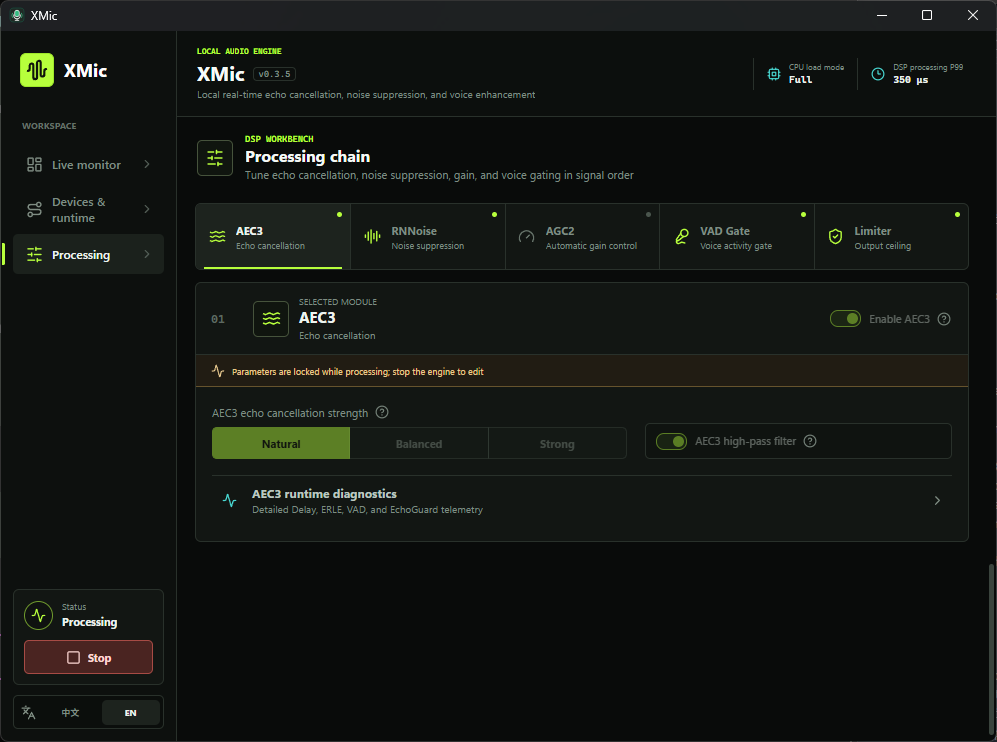

# XMic

**English** | [简体中文](README.zh-CN.md)

XMic is a fully local Windows microphone processing application. It captures audio from a physical microphone and the active playback device, processes it in real time, and sends the result to a virtual microphone. It is designed for speakerphone calls, in-game voice chat, and everyday voice communication.

## Screenshot



## Features

- Uses WebRTC AEC3 to cancel speaker audio picked up by the microphone before it reaches other participants.
- Reduces keyboard, fan, and ambient noise with RNNoise.
- Provides Natural, Balanced, and Strong AEC presets.
- Includes configurable VAD Gate, AGC2, High-pass Filter, and Limiter stages.
- Supports selected microphones and multichannel USB microphones.
- Automatically detects standard VB-CABLE installations by default and supports manually confirmed render/capture endpoint pairs from other virtual audio devices.
- Rebuilds the audio pipeline after the selected/default playback device or microphone remains stable for one second, while ignoring unrelated endpoint churn and keeping one global DSP configuration.
- Runs audio processing in a separate helper process and retries recoverable failures with bounded backoff. Three unexpected helper crashes within 60 seconds block recovery until the main switch is explicitly turned Off and On.
- Uses one “Output while degraded” setting while processing is requested but temporarily unavailable: raw microphone audio or silence. Raw bypasses every DSP stage, including the limiter; silence uses an output-only session when the virtual device is available.
- Falls back as one complete chain during sustained CPU overload and restores processing after load and devices stabilize.
- Keeps the virtual output inactive while the main switch is Off. A temporary capture-only probe can send one notification per app run after sustained speech is detected; it never forwards microphone audio.
- Supports background operation from the system tray. DSP controls edit a shared draft and are applied together through one fallback-backed Apply action; Current active route always shows applied settings and actual endpoints, explicitly identifying a resolved default microphone.
- Supports launch at sign-in and optional automatic processing after startup.
- Pauses processing and releases audio devices while Windows is locked, disconnected, or sleeping, then automatically recovers the preserved desired state after the session returns.
- Processes all audio locally and requires no network connection at runtime.

## Requirements

- Tested on Windows 10 and Windows 11.
- A separately installed [VB-CABLE](https://vb-audio.com/Cable/) is recommended. XMic does not download, install, or bundle a virtual audio driver.
- With a standard VB-CABLE installation, XMic automatically pairs the `CABLE Input` render endpoint with the `CABLE Output` capture endpoint.
- Other virtual audio devices require manually selecting and confirming their render/capture endpoint pair. The pair must be confirmed again if a driver reinstall changes its endpoint IDs or recorded friendly identities.
- Select the virtual device's capture/microphone endpoint as the microphone in games and calling applications.

XMic does not change the default Windows playback device or microphone. When automatic playback reference is enabled, keep the speakers or headphones that actually produce sound as the default Windows playback device. If the virtual microphone is the default Windows microphone, explicitly select the physical microphone in XMic to avoid a feedback route.

## Downloads

Every release publishes four Windows x64 payloads, all listed in `SHA256SUMS.txt`:

| Payload | Use |
| --- | --- |
| `XMic_<version>_x64-setup.exe` | NSIS installer for a normal per-user installation. |
| `XMic.exe` | Standalone executable. Copy one file anywhere and run it. |
| `XMic_x64-portable.zip` | Portable archive. Extract it and run `XMic.exe` from the extracted folder. |
| `XMic_<version>_MPL-2.0-source.zip` | Source Code Form for the MPL-2.0 dependencies. |

Only x64 is published today. The standalone executable and the portable archive require the system Microsoft Edge WebView2 Evergreen Runtime and do not download or install it; the installer keeps its bootstrapper. No edition updates itself: use `scoop update` for a Scoop install, and replace the program files manually otherwise.

### Portable mode

Portable mode activates only when `portable.flag` sits next to the executable. The archive ships a zero-byte `portable.flag` and an initially empty `data/` directory:

```text
XMic_x64-portable/
  XMic.exe
  portable.flag
  data/
```

In portable mode every XMic-owned file stays inside `data/`: the settings file, the helper and managed DSP copies under `data/runtime/`, and the WebView2 profile under `data/webview/`. Portable mode never reads, copies, or migrates the installed edition's configuration and exits with a clear error when `data/` is not writable. Because notification history, crash records, and a launch-at-sign-in entry the user explicitly enables are operating-system state, portable mode does not claim to leave no trace on the host.

A Scoop manifest can persist that folder without XMic maintaining a bucket or manifest:

```json
{
  "version": "<version>",
  "homepage": "https://github.com/mengshouer/XMic",
  "license": "MIT",
  "architecture": {
    "64bit": {
      "url": "https://github.com/mengshouer/XMic/releases/download/v<version>/XMic_x64-portable.zip",
      "hash": "<sha256 from SHA256SUMS.txt>"
    }
  },
  "extract_dir": "XMic_x64-portable",
  "shortcuts": [["XMic.exe", "XMic"]],
  "persist": "data"
}
```

### Replacing the DSP library

The official WebRTC DSP library is embedded in `XMic.exe` and materialized for each run, so a single file is enough to run XMic. A replacement library is resolved in this order and must be replaced while XMic is fully closed; there is no hot swap:

1. `--dsp-library <path>` on that one launch, resolved against the current directory. The path is never stored and the file is never copied.
2. `xmic_webrtc_dsp.dll` next to the executable.
3. `xmic_webrtc_dsp.dll` in the mode-specific `overrides` directory: `%APPDATA%\com.mengshouer.xmic\overrides\` for the standard and standalone editions, `data\overrides\` for portable mode.
4. The embedded official library.

A replacement library is not checksum- or signature-verified, and only the exported symbols and the ABI version are checked. If a selected library is missing, corrupt, or incompatible, XMic does not silently fall back to the embedded one: validation fails closed and audio follows the configured degraded-output policy. Only one XMic instance runs at a time across all editions, so starting a second copy with `--dsp-library` only focuses the running window and reports that the override was not applied.

## Building from Source

Development and packaging require Windows, Node.js 24, Rust 1.97.0, Visual Studio 2022 C++ tools, and a Windows SDK. Node and Rust versions are pinned by `.node-version` and `rust-toolchain.toml`. The repository includes a verified WebRTC DSP DLL, so normal builds do not download or compile WebRTC.

```powershell
npm ci
npm run bundle
```

For frontend development, run `npm run build` or `npm run tauri dev`. `npm run bundle` is the only release-packaging entry point: it checks version consistency, generates license resources from the locked Cargo and npm dependency graphs, verifies the checked-in WebRTC artifact, builds the NSIS installer with Cargo lockfile enforcement, verifies that every license notice is embedded as a lazy frontend chunk, and then prepares and validates `artifacts/release/` including the portable archive, the MPL-2.0 source archive, and `SHA256SUMS.txt`. Ordinary `cargo check`, `cargo test`, and `cargo clippy` commands do not depend on generated license resources.

Rebuilding WebRTC is only necessary after changing `native/webrtc-audio-processing/`, changing the WebRTC build recipe, or updating the WebRTC revision. It additionally requires PowerShell 7, Windows SDK 10.0.26100.0, Debugging Tools for Windows, and at least 20 GB of free disk space:

```powershell
.\scripts\bootstrap-webrtc.ps1
.\scripts\build-webrtc.ps1 -Jobs 2
npm run artifacts:check
```

The WebRTC revision is pinned in `native/webrtc-audio-processing/webrtc-lock.json`. Rebuilding the DLL also generates its third-party notice and `PROVENANCE.json`. `npm run artifacts:check` verifies the DLL, notice, provenance, overlay sources, and lockfile hashes. Missing or stale license text, required source bundles, notices, or WebRTC artifacts block release packaging.

Common checks:

```powershell
npm test
npm run build
cargo test --workspace --locked
npm run bundle
```

See [CONTRIBUTING.md](CONTRIBUTING.md) for the complete contribution and validation workflow.

## License

XMic is licensed under the [MIT License](LICENSE). See [THIRD_PARTY_NOTICES.md](THIRD_PARTY_NOTICES.md) for third-party attribution. Every release embeds the complete dependency notices in the About page and publishes the MPL-2.0 Source Code Form as `XMic_<version>_MPL-2.0-source.zip`.

The Windows installer, the standalone executable, and the portable archive are all unsigned. Release pages provide `SHA256SUMS.txt` and an unsigned-binary warning, while a GitHub build attestation records build provenance. Verify the SHA-256 checksum before running any payload, and expect Windows SmartScreen to report an unknown publisher.
