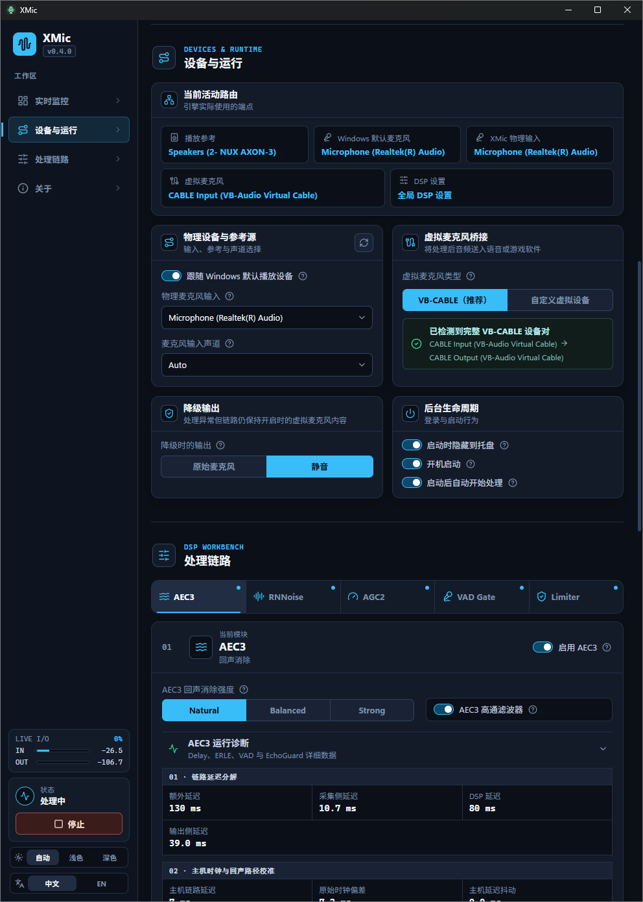

# XMic

[English](README.md) | **简体中文**

XMic 是一款纯本地运行的 Windows 麦克风处理工具。它从物理麦克风和当前播放设备采集音频，在实时处理后将声音输出到虚拟麦克风，适用于使用音响通话、游戏语音和日常连麦。

## 软件截图



## 功能

- 使用 WebRTC AEC3 消除音响回声，能够实现麦克风接收到的音响声音在对方听到时被消除。
- 使用 RNNoise 降低键盘、风扇和环境底噪。
- 提供 Natural、Balanced 和 Strong 三种 AEC 处理强度。
- 提供可调节的 VAD Gate、AGC2、High-pass Filter 和 Limiter。
- 支持指定麦克风以及多通道 USB 麦克风。
- 默认自动识别标准 VB-CABLE，并支持手动确认其他具有 render/capture endpoint pair 的虚拟音频设备。
- 所选/默认播放设备或麦克风变化并稳定 1 秒后自动重建音频链路；无关 endpoint 变化不会打断音频，所有设备共用一份全局 DSP 设置。
- 音频处理运行在独立 helper process；可恢复故障按有界退避自动重试。60 秒内连续异常退出三次后会阻止恢复，必须明确关闭再开启主开关。
- 通过「降级时的输出」决定已请求处理但链路暂不可用时的内容：原始麦克风或静音。Raw 会绕过包括 Limiter 在内的全部 DSP；静音会在虚拟输出可用时使用 output-only session。
- 持续 CPU 过载时整条 DSP 链统一退化，并在设备与负载稳定后自动恢复。
- 主开关关闭时虚拟输出保持未激活。临时 capture-only probe 检测到持续语音后每次应用运行最多提醒一次，但不会转发麦克风声音。
- 支持系统托盘后台运行。DSP 控件统一修改 draft，并通过一次由 fallback 承接的 Apply 提交；“当前活动路由”始终显示已应用设置和实际 endpoint，跟随默认麦克风时会明确标注解析结果。
- 支持开机启动以及启动后自动开始处理。
- 锁屏、断开 Windows 会话或睡眠时暂停处理并释放音频设备；会话恢复后根据保留的用户意图自动恢复。
- 所有音频均在本机处理，软件运行时不需要联网。

## 使用要求

- 在 Windows 10 / Windows 11 上测试通过。
- 推荐单独安装 [VB-CABLE](https://vb-audio.com/Cable/)。XMic 不会下载、安装或捆绑虚拟音频驱动。
- 使用标准 VB-CABLE 时，XMic 会自动匹配 `CABLE Input` 写入端和 `CABLE Output` 读取端。
- 使用其他虚拟音频设备时，需要在 XMic 中手动选择写入端和读取端，并确认该 endpoint pair。驱动重装导致 endpoint ID 或已记录的 friendly identity 变化后需要重新确认。
- 在游戏或通话软件中选择虚拟设备的 capture/microphone 读取端作为麦克风。

XMic 不会修改 Windows 默认播放设备或默认麦克风。使用自动播放参考时，实际发声的音响或耳机应保持为 Windows 默认播放设备。若将虚拟麦克风设为 Windows 默认麦克风，需要在 XMic 中明确选择实际使用的物理麦克风，避免形成回授路由。

## 下载

每个 release 都会发布四个 Windows x64 产物，全部登记在 `SHA256SUMS.txt` 中：

| 产物 | 用途 |
| --- | --- |
| `XMic_<version>_x64-setup.exe` | NSIS 安装包，适合常规的当前用户安装。 |
| `XMic.exe` | 单文件可执行程序。复制到任意位置即可运行。 |
| `XMic_x64-portable.zip` | 便携包。解压后直接运行其中的 `XMic.exe`。 |
| `XMic_<version>_MPL-2.0-source.zip` | MPL-2.0 依赖对应的 Source Code Form。 |

当前仅发布 x64。裸 EXE 与便携包依赖系统已安装的 Microsoft Edge WebView2 Evergreen Runtime，不会自行下载或安装；installer 保留原有的 bootstrapper。所有形态都不会自我更新：Scoop 安装使用 `scoop update`，其他情况手动替换程序文件。

### 便携模式

只有 `portable.flag` 与可执行文件同目录时才会进入便携模式。便携包包含一个 0 字节 `portable.flag` 和初始为空的 `data/`：

```text
XMic_x64-portable/
  XMic.exe
  portable.flag
  data/
```

便携模式下 XMic 自有文件全部留在 `data/`：设置文件、`data/runtime/` 下的 helper 与 managed DSP 副本、以及 `data/webview/` 下的 WebView2 profile。便携模式不会读取、复制或迁移安装版的配置；`data/` 不可写时会给出明确错误并退出。通知历史、崩溃记录以及用户主动开启的开机启动项属于操作系统状态，因此便携模式不声称对宿主机完全无痕。

一个 Scoop manifest 就能保留该目录，XMic 本身不维护 bucket 或 manifest：

```json
{
  "version": "<version>",
  "homepage": "https://github.com/mengshouer/XMic",
  "license": "MIT",
  "architecture": {
    "64bit": {
      "url": "https://github.com/mengshouer/XMic/releases/download/v<version>/XMic_x64-portable.zip",
      "hash": "<SHA256SUMS.txt 中的 sha256>"
    }
  },
  "extract_dir": "XMic_x64-portable",
  "shortcuts": [["XMic.exe", "XMic"]],
  "persist": "data"
}
```

### 替换 DSP 库

官方 WebRTC DSP 库已内嵌在 `XMic.exe` 中并在每次运行时落盘，因此单个文件即可运行 XMic。替换库按以下顺序解析，必须在完全退出 XMic 后替换，且不支持热替换：

1. 该次启动的命令行参数 `--dsp-library <path>`，按当前工作目录解析；该路径不会被保存，文件也不会被复制。
2. 与可执行文件同目录的 `xmic_webrtc_dsp.dll`。
3. 模式专属 `overrides` 目录中的 `xmic_webrtc_dsp.dll`：安装版与裸 EXE 使用 `%APPDATA%\com.mengshouer.xmic\overrides\`，便携模式使用 `data\overrides\`。
4. 内嵌的官方库。

替换库不做 checksum 或签名校验，只检查导出符号与 ABI 版本。若选中的库缺失、损坏或不兼容，XMic 不会静默回退到内嵌库：验证会 fail closed，音频遵循已配置的降级输出策略。所有形态同一时间只允许一个 XMic 实例，因此在已有实例运行时再执行带 `--dsp-library` 的副本只会聚焦现有窗口并提示 override 未生效。

## 从源码构建

开发和打包需要 Windows、Node.js 24、Rust 1.97.0、Visual Studio 2022 C++ tools 以及 Windows SDK。Node 和 Rust 版本分别由 `.node-version`、`rust-toolchain.toml` 固定。仓库已经包含经过校验的 WebRTC DSP DLL；普通构建不需要下载或编译 WebRTC。

```powershell
npm ci
npm run bundle
```

前端开发可以只运行 `npm run build` 或 `npm run tauri dev`。`npm run bundle` 是唯一的 release packaging 入口：它会校验版本一致性，根据锁定的 Cargo 和 npm dependency graph 生成许可资源，检查仓库中的 WebRTC artifact，在 Cargo lockfile 保护下构建 NSIS installer，校验所有 license notice 都以懒加载前端 chunk 的形式内嵌，最后生成并校验 `artifacts/release/`，包括便携包、MPL-2.0 source archive 和 `SHA256SUMS.txt`。普通 `cargo check`、`cargo test` 和 `cargo clippy` 不依赖这些 generated license resources。

只有修改 `native/webrtc-audio-processing/`、WebRTC build recipe 或升级 WebRTC revision 时，才需要额外准备 PowerShell 7、Windows SDK 10.0.26100.0、Debugging Tools for Windows 和至少 20 GB 可用空间，然后执行：

```powershell
.\scripts\bootstrap-webrtc.ps1
.\scripts\build-webrtc.ps1 -Jobs 2
npm run artifacts:check
```

WebRTC 版本由 `native/webrtc-audio-processing/webrtc-lock.json` 固定。构建 WebRTC DLL 时会同时生成对应的第三方许可清单和 `PROVENANCE.json`；`npm run artifacts:check` 会校验 DLL、notice、provenance、overlay source 和 lock 中的 SHA-256。缺少或过期的 license text、required source bundle、notice 或 WebRTC artifact 会阻止 release packaging。

常用检查：

```powershell
npm test
npm run build
cargo test --workspace --locked
npm run bundle
```

完整的贡献和检查流程见 [CONTRIBUTING.md](CONTRIBUTING.md)。

## 许可证

XMic 使用 [MIT License](LICENSE)。第三方组件的归属说明见 [THIRD_PARTY_NOTICES.md](THIRD_PARTY_NOTICES.md)。每个 release 都会把完整的依赖许可清单内嵌到「关于」页面，并单独发布 MPL-2.0 的 Source Code Form：`XMic_<version>_MPL-2.0-source.zip`。

Windows installer、裸 EXE 与便携包均未进行 code signing。发布页会提供 `SHA256SUMS.txt` 和 unsigned 提示，GitHub build attestation 记录构建来源；运行任何产物前请先核对 SHA-256，并注意 Windows SmartScreen 可能显示未知发布者。
